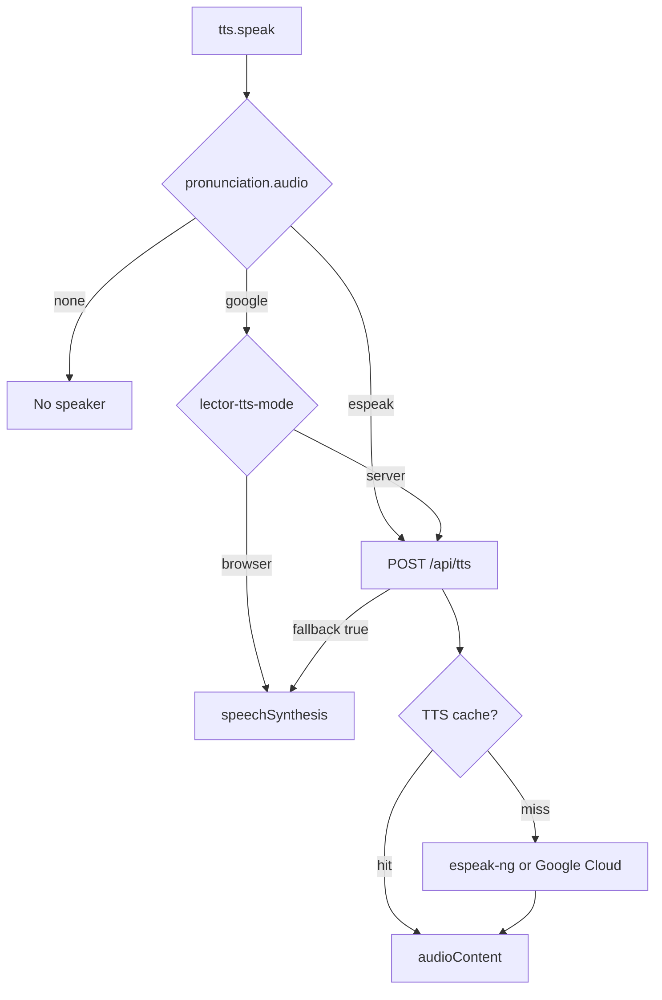
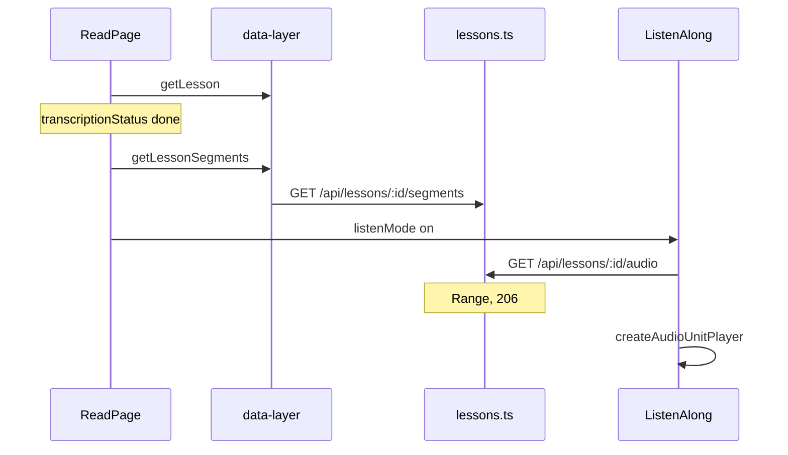
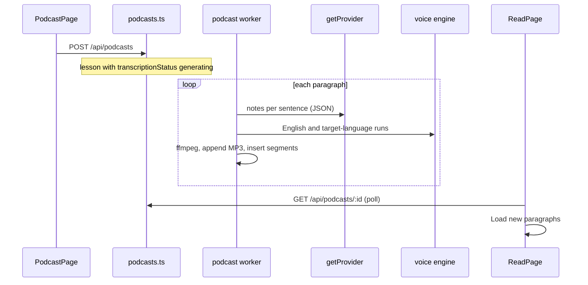

# Listen domain

This domain is speech and audio lessons. YouTube captions share the Reader. They do not share the podcast player.

## Speak word

**App domain:** Listen

The drawer, the reader tap, and practice call `speak`.

### Key files

| Role | Path | Function |
| --- | --- | --- |
| Client | `src/lib/tts.ts` | `speak`, `speakWithServer`, `speakWithBrowser`, `hasAudio` |
| Settings | `src/app/settings/components/TTSSettings/index.tsx` | `TTSSettings` |
| API | `api/src/routes/tts.ts` | `POST /` |
| Cache | `api/src/lib/tts-cache.ts` | `getTtsCache`, `ttsCacheKey` |

Mode lives in `localStorage` key `lector-tts-mode`. Cloud Free with `ttsCharsPerMonth === 0` forces browser mode. A Google miss or absent key returns `{ fallback: true }`. Esperanto eSpeak does not fall back to the browser.

### Tables

No audio blob table. Meter is `usage_counters` for Google characters.

## Listen-along

**App domain:** Listen

Podcast import is the Library domain. Playback is this domain.

| Role | Path | Function |
| --- | --- | --- |
| Reader | `src/app/read/[bookId]/page.tsx` | listen mode toggle |
| Player | `src/components/ListenAlong/index.tsx` | `ListenAlong` |
| Units | `src/components/ListenAlong/drill-player.ts` | `createAudioUnitPlayer` |
| Client | `src/lib/data-layer.ts` | `getLessonSegments`, `lessonAudioUrl` |
| API | `api/src/routes/lessons.ts` | `GET /:id/segments`, `GET /:id/audio` |
| Worker | `api/src/lib/transcribe-worker.ts` | `applyTranscript` |

Word tap pauses and opens the Translation drawer. A drag across words, or a long-press drag on touch, looks up the phrase the same way, and does not seek. Shadow mode repeats a unit.

On AnkiConnect, each line has a hover button that adds the line to Anki. See [Push to Anki](anki.md#push-to-anki).

Tables: `lessons`, `transcript_segments`. Files under `AUDIO_DIR`.

Tests: `e2e/audio-import.spec.ts`, `e2e/transcript-line-anki.spec.ts`.

## Podcast episodes

**App domain:** Listen

The Podcast tab turns a chapter, or a range of its paragraphs, into a slow-reading episode. For each sentence the narrator reads it slowly, explains the words the user does not know yet in English, then the grammar and figures of speech. Each paragraph ends with a normal-speed reading, then an English translation of the paragraph. The episode is an audio lesson, so it plays in listen-along.

| Role | Path | Function |
| --- | --- | --- |
| Screen | `src/app/podcast/page.tsx` | `PodcastPage`, `NewEpisode`, `ShowList`, `FeedPanel` |
| Settings | `src/app/settings/components/PodcastSettings/index.tsx` | `PodcastSettings` |
| Client | `src/lib/podcast.ts` | `getPodcasts`, `createPodcast`, `getPodcastEpisode` |
| API | `api/src/routes/podcasts.ts` | `makePodcastRoutes` |
| Script | `api/src/lib/podcast/script.ts` | `UnknownWordFinder`, `planSentences`, `writeParagraphScript`, `assembleParagraph` |
| Voices | `api/src/lib/podcast/engines.ts` | `createPodcastVoice` |
| Audio | `api/src/lib/podcast/audio.ts` | `renderParagraph`, `appendEpisodeAudio` |
| Worker | `api/src/lib/podcast/worker.ts` | `processNextParagraph`, `startPodcastWorker` |
| Store | `api/src/lib/podcast/store.ts` | `createEpisode`, `deleteEpisode` |
| Narration | `languages/narration.ts` | `splitNarration` |

- The worker runs only with `PODCAST_WORKER=1`. Each tick writes one paragraph and commits it with its transcript rows, so a restart resumes at the next paragraph. A failed paragraph waits 30 seconds and has 3 attempts. A plan limit stops the episode at once.
- Unknown words come from `knownWords`. With a dictionary, `VocabMatcher` counts inflected forms and grammar words as known. The `podcastExplainBelow` setting picks the threshold; the default explains new, level 1 and level 2 words. A word is explained once per episode (`podcast_episodes.explained`). `lookupWord` supplies the dictionary facts for the prompt.
- A word note gives one English translation as the word is used, and a second only when one word cannot carry the meaning. It may name the grammatical form, such as the genitive, but not the dictionary form. The model also returns the paragraph's English translation (`parseTranslation`), read after the normal-speed reading.
- A paragraph longer than 500 characters or 3 sentences is read in chunks (`chunkSentences`). Each chunk has its own script call, normal-speed reading and translation, under "Paragraph N, continued.". Progress still counts book paragraphs.
- The model writes only the notes and the translation. Code assembles the lines, so the source sentences are read exactly as written. Narration wraps target-language words in «»; `splitNarration` splits each line into voice runs, and non-Latin words outside «» also count as target text.
- Engines: Google Cloud (`GOOGLE_CLOUD_API_KEY`, a Chirp 3 HD persona, the standard voice as a fallback), a local OpenAI-compatible `/v1/audio/speech` server (`PODCAST_TTS_*`; `{lang}` in a voice name becomes the episode's language code), and ElevenLabs (`ELEVENLABS_*`). Local and ElevenLabs are self-host only. Every run goes through the TTS cache. Google is metered by `ttsCharsPerMonth`.
- Slow reads are slowed with ffmpeg `atempo` (`podcastSlowTempo`, default 0.75), because Chirp 3 HD has no rate control. Paragraphs are headerless CBR MP3, appended byte for byte to the lesson file, so the byte count gives the duration.
- Each book gets one podcast collection, "<book> · Podcast" (`podcast_shows`). Episode `sortOrder` is chapter × 10000 + first paragraph. Lessons outside a collection share a "Podcasts" show.
- Narration rows carry `transcript_segments.lang = 'en'`. Listen-along shows them muted; only their «» words are interactive, and a tap saves the nearest lesson-language line as the sentence. Narration rows get no Anki line button, and shadow mode skips them.
- The RSS feed is self-host only: `GET /api/podcasts/feed/:token/:showId`, one show per book, finished episodes only. The token is stored hashed in `podcast_feed_tokens`; the browser that created it keeps it in `localStorage` to build the URLs.

Tables: `podcast_shows`, `podcast_episodes`, `podcast_feed_tokens`, `lessons`, `transcript_segments`. Audio under `AUDIO_DIR`.

Tests: `api/src/lib/podcast/*.test.ts`, `api/src/routes/podcasts.test.ts`, `src/lib/__tests__/podcast.test.ts`, `src/components/ListenAlong/utils.test.ts`, `languages/narration.test.ts`, `e2e/podcast.spec.ts`.

## YouTube captions

**App domain:** Listen. Import is the Library domain.

| Role | Path | Function |
| --- | --- | --- |
| Reader | `src/components/MarkdownReader/index.tsx` | youtube branch |
| Player | `src/components/YouTubePlayer/index.tsx` | `seekTo` |
| Cues | `src/components/MarkdownReader/TranscriptReader.tsx` | `onSeek`, `onWordClick` |

Cues live on `lessons.segments` JSON, not `transcript_segments`. Listen-along does not mount.

Tests: `e2e/youtube-transcript.spec.ts`.
