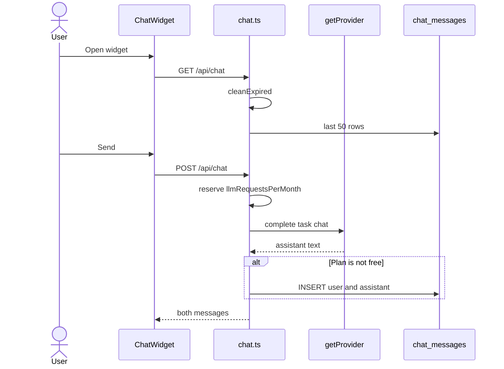
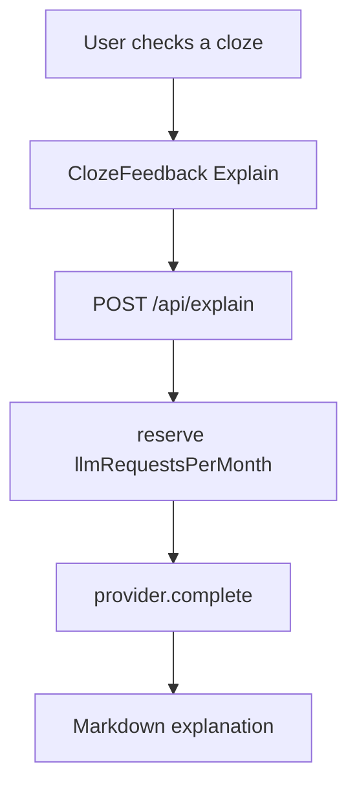

# Tutor domain

This domain is help from a large language model (LLM). It is not a dictionary gloss. Journal correction is the Journal domain. It uses the same `getProvider` stack.

## Tutor chat

**App domain:** Tutor

The Chat widget sits in `src/app/layout.tsx`. Auth routes with no chrome hide it.

### Key files

| Role | Path | Function |
| --- | --- | --- |
| Widget | `src/components/ChatWidget/index.tsx` | `fetchMessages`, `sendMessage`, `clearChat`, `loadMore` |
| Prompts | `src/components/ChatWidget/constants.ts` | `EXAMPLE_PROMPTS` |
| API | `api/src/routes/chat.ts` | `GET /`, `POST /`, `DELETE /` |
| Provider | `api/src/lib/llm/index.ts` | `getProvider` |

The widget calls `apiFetch` itself. The widget does not use `getChatMessages` or `sendChatMessage` in `data-layer.ts`.

### Branches

- If the send is empty, it stays disabled. API returns 400.
- History is per language.
- Free plan does not persist. Free BYOK does not persist. A refresh shows an empty thread.
- Paid history has a 7-day time to live.
- Context is 19 prior rows plus the new message. The route prepends the system prompt into the first user turn so Anthropic works.
- Chat is not in data takeout.

### Tables

`chat_messages`, `usage_counters`.

### Tests

`e2e/chat.spec.ts`, `e2e/chat-language.spec.ts`.

## Conversation

**App domain:** Tutor

The Conversation tab. The learner talks with an AI partner, by voice or by typing. The partner keeps to the learner's words. Conversations are saved on the server and can be reopened.

| Role | Path | Function |
| --- | --- | --- |
| Screen | `src/app/conversation/page.tsx` | `ConversationPage` |
| Parts | `src/app/conversation/components/` | `ClickableText`, `ChatList`, `RecordingPanel` |
| Settings | `src/app/settings/components/ConversationSettings/index.tsx` | `ConversationSettings` |
| Client | `src/lib/conversation.ts` | `createChat`, `sendTurn`, `retryReply`, `buildChatRecording`, `importBrowserConversation` |
| Definitions | `src/lib/use-word-panel.ts` | `useWordPanel` |
| Speech | `src/lib/stt/use-speech-capture.ts` | `useSpeechCapture` |
| API | `api/src/routes/conversation.ts` | `GET /voices`, `POST /speak`, `/chats` and `/chats/:id/*` |
| Storage | `api/src/lib/conversation-store.ts` | `appendMessage`, `saveRecording`, `buildRecording` |
| Logic | `api/src/lib/conversation.ts` | `buildConversationReply`, `correctLearnerTurn`, `meterFor` |
| Diff | `src/lib/correction-diff.ts` | `diffCorrection` |

- `conversations` and `conversation_messages` hold each chat. Files live in `DATA_DIR/conversations/<id>/`: one MP3 per spoken learner turn, and `conversation.mp3` for the stitched recording. Deleting a chat removes its folder; account erasure does too.
- `POST /chats` writes the opening reply; a failed opening leaves no chat. `POST /chats/:id/turns` is multipart: `text`, `newPercent` and an optional `audio` file. It saves the learner turn first, so a failed reply leaves it in place and `POST /chats/:id/reply` retries.
- The API puts the last 20 turns into the prompt, after a system prompt with up to 800 of the learner's words and up to 25 learning words. The new-word limit (`newPercent`, 0 to 20, default 3) comes from Settings. `CoverageMeter` measures each reply; a reply more than 5 points over the limit is rewritten once. `meterFor` caches the meter for 10 minutes, or until the number of known words changes.
- Speech input uses `startRecognition` with `maxSeconds: 120`. In auto-stop mode a pause ends the turn: 2.5 s by default, 1 to 8 s in Settings; in press-stop mode only the stop button or the two-minute cap does. The browser keeps the captured 16 kHz PCM and uploads it as WAV; the API stores it as MP3.
- Starting the microphone cancels any reply audio, including audio still loading, so a late reply never plays over the learner. A reply arriving while the microphone is on does not auto-play.
- `POST /chats/:id/recording` decodes each turn with the podcast ffmpeg toolkit, joins them with 700 ms pauses and encodes one MP3. Partner turns use the chosen engine through the TTS cache; typed learner turns are skipped. `recordingMessages` lets the screen offer an update when the chat has grown.
- Each word in a bubble opens the definition drawer: dictionary first, then an AI gloss, with level, known and ignore actions that write `vocab` and `knownWords`. The drawer's Add to Anki button sits in its header here (`ankiInHeader`) and uses the practice page's `addPracticeWordToAnki`.
- With Corrections on (header switch, localStorage), a turn is sent with `correct=1`. `correctLearnerTurn` runs beside the reply, as a second LLM request, and its result is stored in `conversation_messages.correction`; a failed check only leaves the turn unchecked. `POST /chats/:id/messages/:idx/correction` checks an earlier turn. A spoken turn is checked as a transcript, so punctuation, capitals and likely mis-hearings do not count. The screen shows the turn again under the bubble, with `diffCorrection` marking removed words struck through and added words in red, and a Why? toggle for the full explanation.
- A conversation that earlier versions kept in localStorage is imported once, then removed from the browser.

Tests: `api/src/lib/conversation.test.ts`, `api/src/routes/conversation.test.ts`, `src/lib/__tests__/conversation.test.ts`, `src/lib/stt/audio.test.ts`, `src/lib/__tests__/correction-diff.test.ts`, `e2e/conversation.spec.ts`.

## Cloze Explain

**App domain:** Tutor

After a cloze Check, Explain asks for a prose breakdown of that sentence. Dictation has no Explain.

| Role | Path | Function |
| --- | --- | --- |
| Feedback | `src/app/practice/components/Feedback/index.tsx` | wraps `ClozeFeedback` |
| Button | `src/components/ClozeFeedback/index.tsx` | `handleExplain` |
| API | `api/src/routes/explain.ts` | `POST /` |

The route does not persist the text. Free managed allowance is 0. After a success, the button stays disabled.

Tests: `e2e/explain.spec.ts`.
